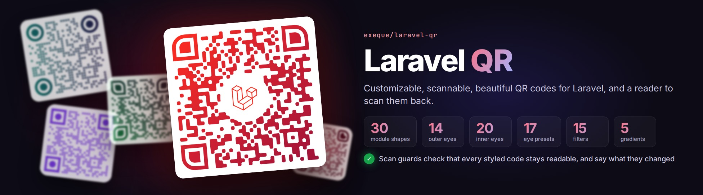
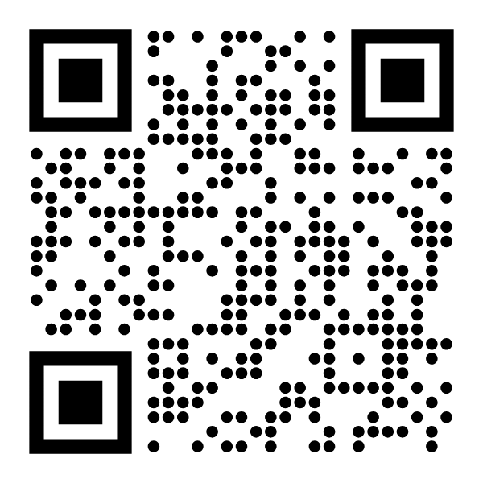
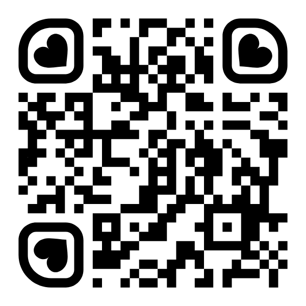
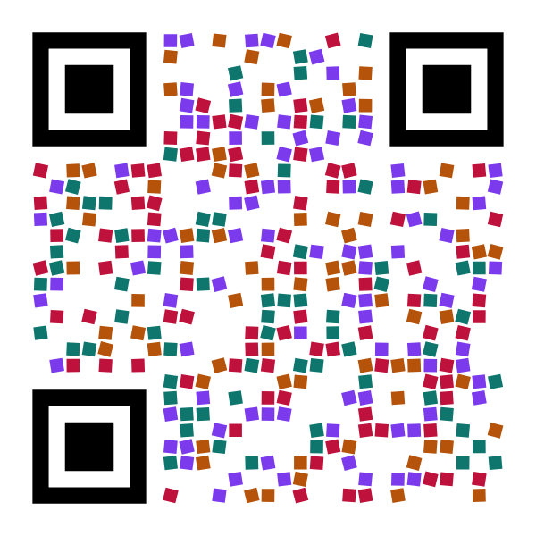

<p align="center"></p>

<p align="center">
<a href="https://packagist.org/packages/exeque/laravel-qr"></a>
<a href="https://packagist.org/packages/exeque/laravel-qr"></a>
<a href="https://github.com/ExeQue/laravel-qr/actions/workflows/tests.yml"></a>
<a href="https://github.com/ExeQue/laravel-qr/actions/workflows/docs.yml"></a>


<a href="LICENSE.md"></a>
</p>

# Laravel QR

**Documentation: [exeque.github.io/laravel-qr](https://exeque.github.io/laravel-qr/)**

Customizable, scannable, beautiful QR codes for Laravel, and a reader to scan them back.

| 33 | 15 | 21 | 18 | 24 | 5 |
|:---:|:---:|:---:|:---:|:---:|:---:|
| module shapes | outer eyes | inner eyes | eye presets | filters | gradients |

Scan guards check that every styled code stays readable, and say what they changed.

```php
use ExeQue\Qr\Facades\Qr;
use ExeQue\Qr\Gradients\LinearGradient;

Qr::url('https://example.com/e/ABCD1234')
    ->modules('flowing-medium')
    ->eyes('rounded')
    ->paint(LinearGradient::make('#be123c', '#1e1b4b')->angle(135))
    ->png(600)
    ->store('codes/launch.png');
```

| | | | |
|---|---|---|---|
|  |  |  |  |

- **Content** - links, Wi-Fi logins, contact cards, email, text messages, places and calendar events, escaped the way
  phones read them; or any text, in any language.
- **Shapes** - thirty-three module shapes, from squares and dots to flowing, organic and connected modules; fifteen outer
  eyes, twenty-one inner eyes and eighteen presets.
- **Color** - every CSS color space, your own color names, and linear, radial, conic, diamond and mesh gradients
  blended in OKLab.
- **Filters** - turn, size, nudge, shade, recolor or reshape every module on its own, in waves or from the middle out.
- **Logos** - from files, disks or bytes, on a plate, cut to a shape; SVG logos sanitized.
- **Scan safety** - guards that keep every styled code readable, and say what they changed.
- **Output** - SVG, PNG, JPEG and WebP; saved, stored, downloaded, streamed or returned as a response; with
  attribution written into the file.
- **Blade** - `<x-qr :content="$url" />`, and icons of every shape for style pickers.
- **Validation** - `StyleRule` checks a style from a form, field by field, and turns it into a style.
- **Reading** - `Qr::read()` reads codes from images, with the package's own decoder or zxing.
- **Caching**, a **testing fake**, **events**, a **Monocle** lens, **artisan** commands, and a
  [Laravel Boost](docs/installation.md#laravel-boost) skill for AI agents.

Every built-in shape is checked with a real decoder, as SVG and as PNG.

## Make it yours

Nearly everything is open to change. Register your own module shapes, eyes, filters, gradients, content types,
writers and decoders by name, and use them like the built-in ones; name whole styles in config and apply them with
`->style('brand')`; turn any shape's options, from corner radii to the way a drop points; or bind your own class in
place of any of the package's services. See [Extending](docs/extending.md).

## Install

```bash
composer require exeque/laravel-qr

# The config, to change the defaults and name styles and parts of your own (optional)
php artisan vendor:publish --tag=qr-config

# Recommended
# Imagick, for faster PNG, JPEG and WebP than GD (or your system's package, such as php8.5-imagick)
pecl install imagick
# SVG logos on PNG, JPEG and WebP codes: Alpine
apk add imagemagick-svg
# SVG logos on PNG, JPEG and WebP codes: Ubuntu 24.04 (Debian 13 has it already)
apt install libmagickcore-6.q16-7-extra
# HEIC, HEIF and AVIF logos: Alpine (Ubuntu and Debian have it already)
apk add imagemagick-heic
# The zxing reader, reading SVG too
php artisan qr:install --svg
# A dedicated sanitizer for SVG logos
composer require enshrined/svg-sanitize
# See the codes each request rendered, in the Monocle profiler
composer require --dev exeque/laravel-monocle
```

PHP 8.5 and Laravel 13. SVG needs nothing more; PNG, JPEG and WebP need Imagick or GD.

To read codes with zxing, the most capable reader, install `zxing-wasm` with your package manager (found from your
lock file, or asked):

```bash
php artisan qr:install
```

### Recommended

- **The Imagick extension**, for PNG, JPEG and WebP output: 10 to 40 % faster than GD, which is used without it, and
  needed for SVG logos on raster codes. ImageMagick 6 and 7 both work.
- **ImageMagick's SVG support**, to put SVG logos on PNG, JPEG and WebP codes: `imagemagick-svg` on Alpine,
  `libmagickcore-6.q16-7-extra` on Ubuntu 24.04; Debian 13 has it with ImageMagick (`libmagickcore-7.q16-10-extra`).
- **Node.js with `zxing-wasm`**, through `php artisan qr:install`, to read codes with zxing; add `--svg` to read SVG
  images too.
- [`enshrined/svg-sanitize`](https://github.com/darylldoyle/svg-sanitizer), to sanitize SVG logos with a dedicated
  sanitizer instead of the package's own allowlist.
- [`exeque/laravel-monocle`](https://github.com/ExeQue/laravel-monocle), to see the codes each request rendered, with
  timings and advice.

## Documentation

Start with [Getting started](docs/getting-started.md), or the [documentation index](docs/README.md).

## Thanks

To [bacon/bacon-qr-code](https://github.com/Bacon/BaconQrCode), for years of fantastic work on QR codes in PHP.

## License

MIT, see [LICENSE.md](LICENSE.md).
