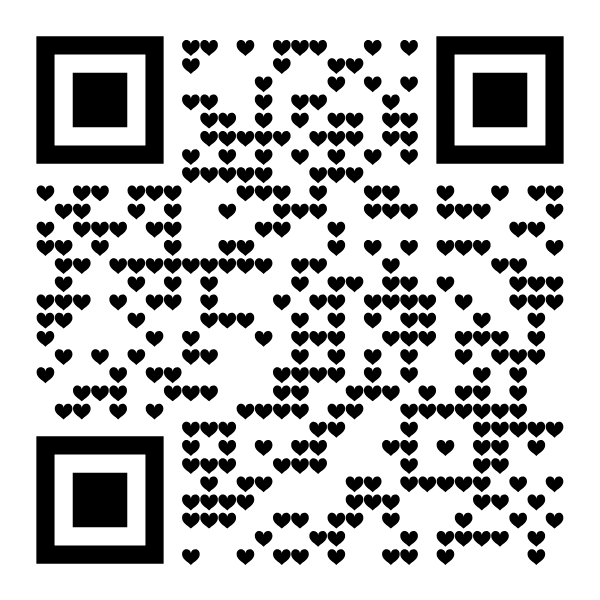
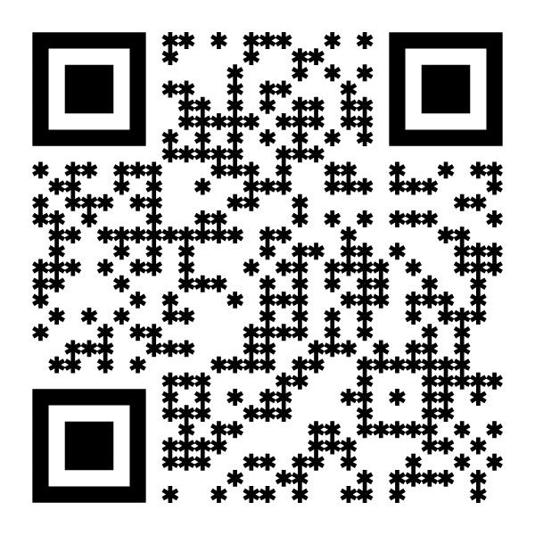
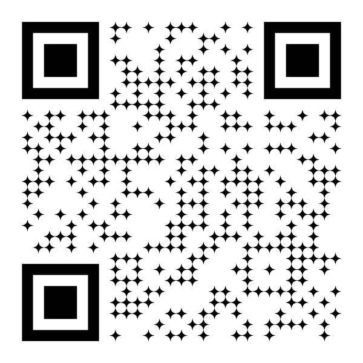

# Modules

A module shape draws each dark module of the code. Use one by its name, its `Module` enum case, its class or an
instance with options:

```php
use ExeQue\Qr\Shapes\Enums\Module;
use ExeQue\Qr\Shapes\Modules\Dot;

Qr::url($url)->modules('dots-medium');
Qr::url($url)->modules(Module::DotsMedium);
Qr::url($url)->modules(Module::DotsMedium, diameter: 0.7);   // a preset with an option changed
Qr::url($url)->modules(new Dot(diameter: 0.7));
```

Every built-in shape scans, as SVG and as PNG; the test suite checks it with a real decoder.

## Square

| | |
|---|---|
|  | `square` · `Modules\Square`<br>The whole cell. The classic look, and the smallest SVG. |

## Dots

| | | |
|---|---|---|
|  |  |  |
| `dots-small` | `dots-medium` | `dots-large` |

`Modules\Dot` · option `diameter`, 0.1 to 1 modules (0.6, 0.8 and 1.0 in the presets).

## Flowing

Neighboring modules melt into each other: a run of modules is one bar with straight sides, outer corners are rounded,
and inner elbows get a fillet so the code looks poured rather than cut. A module on its own becomes a circle at the
strongest setting; modules touching only at a corner stay apart.

| | | |
|---|---|---|
|  |  |  |
| `flowing-soft` | `flowing-medium` | `flowing-strong` |

`Modules\Flowing` · options:

| Option | Default | |
|---|---|---|
| `radius` | 0.35 | the rounding, 0 (square) to 0.5 (round); 0.2, 0.35 and 0.5 in the presets |
| `concave` | `true` | fillet the inside of elbows; `false` rounds the outer corners only |

```php
Qr::url($url)->modules('flowing-medium', radius: 0.42, concave: false);
```

Flowing modules never join the eyes, and stop short of the area a logo clears.

## Shapes

| | | | |
|---|---|---|---|
|  |  |  |  |
| `rounded` | `squircles` | `hearts` | `diamonds` |
|  |  |  |  |
| `flowers` | `stars` | `snowflakes` | `hexagons` |
|  |  |  |  |
| `octagons` | `leaves` | `drops` | `sparkles` |
|  |  |  |  |
| `crosses` | `clovers` | `pills` | `bricks` |
|  | | | |
| `sketch` | | | |

| Name | Class | Options |
|---|---|---|
| `rounded` | `Modules\Rounded` | `side` 0.92 (0.1 to 1), `radius` 0.3 (0 to 0.5) |
| `squircles` | `Modules\Squircle` | `side` 0.94 (0.1 to 1): a square with soft, full sides |
| `hearts` | `Modules\Heart` | `height` 1.0 (0.1 to 1.2), its weight moved onto the middle of the cell |
| `diamonds` | `Modules\Diamond` | `radius` 0.5, middle to corner (0.1 to 0.6) |
| `flowers` | `Modules\Flower` | `petal` 0.19, `reach` 0.31, `heart` 0.25, `petals` 6 (3 to 12) |
| `stars` | `Modules\Star` | `outer` 0.52, `inner` 0.34, `points` 5 (3 to 12) |
| `snowflakes` | `Modules\Snowflake` | `reach` 0.52, `width` 0.26 |
| `hexagons` | `Modules\Hexagon` | `radius` 0.5 (0.1 to 0.6), point up |
| `octagons` | `Modules\Octagon` | `side` 0.96 (0.1 to 1), a regular octagon |
| `leaves` | `Modules\Leaf` | `side` 0.94, `point` top-left, `seed` 0: two opposite corners fully round, the other two pointed |
| `drops` | `Modules\Drop` | `side` 0.94, `point` top-left, `seed` 0: three corners round, one pointed |
| `sparkles` | `Modules\Sparkle` | `radius` 0.56 (0.2 to 0.6), `pinch` 0.32 (0.1 to 1): a four-pointed sparkle |
| `crosses` | `Modules\Cross` | `width` 0.4 (0.1 to 1): a plus |
| `clovers` | `Modules\Clover` | a four-leaf clover |
| `pills` | `Modules\Pill` | `width` 0.6 (0.2 to 1): a pill standing up |
| `bricks` | `Modules\Brick` | `height` 0.76 (0.3 to 1): rows read as courses of bricks |
| `sketch` | `Modules\Sketch` | `wobble` 0.06 (0 to 0.1): a square drawn by hand, each its own way |

`point` picks the pointed corner of drops and leaves: `top-left`, `top-right`, `bottom-right`, `bottom-left`, or
`random` for a corner picked for each module from its place, the same on every render. Another `seed` gives `random`
other corners:

```php
Qr::url($url)->modules('drops', point: 'random');
Qr::url($url)->modules('leaves', point: 'top-right');
```

Options outside their range throw an `InvalidOptionException` naming the option and the range.

## Joined shapes

These look at their neighbors, like flowing modules, each in its own way.

| | | | |
|---|---|---|---|
|  |  |  |  |
| `lines-vertical` | `lines-horizontal` | `connected-dots` | `classy` |
|  |  | | |
| `bubbles` | `organic` | | |

| Name | Class | Options |
|---|---|---|
| `lines-vertical`, `lines-horizontal` | `Modules\Lines` | `vertical` true or false, `width` 0.72 (0.2 to 1): modules joined one way only, into lines with round ends |
| `connected-dots` | `Modules\ConnectedDots` | `diameter` 0.72 (0.3 to 1), `bridge` 0.26: dots joined to their neighbors by narrow bridges |
| `classy` | `Modules\Classy` | `radius` 0.5 (0 to 0.5): each group's outer top-left and bottom-right corners rounded |
| `bubbles` | `Modules\Bubbles` | `smallest` 0.55, `largest` 0.95: a dot that grows with the number of neighbors |
| `organic` | `Modules\Organic` | `least` 0.28, `most` 0.5: joined like flowing modules, each outer corner rounded by its own amount |

## Mixing shapes, and scattered looks

The [`mixed-shape`](filters.md#mixed-shape) filter gives each module a shape from a list, and the other filters turn,
size and color modules one by one. Confetti, for instance, is small squares turned every way:

```php
Qr::url($url)
    ->modules('rounded', side: 0.8, radius: 0)
    ->filter('mixed-rotation', min: -15, max: 15)
    ->filter('palette', colors: ['#be123c', '#7c3aed', '#0f766e', '#b45309']);
```


## Shapes of your own

A module shape is a class implementing `ExeQue\Qr\Shapes\Contracts\ModuleShape`, which draws one module about its
middle. See [Extending](extending.md#module-shapes).
